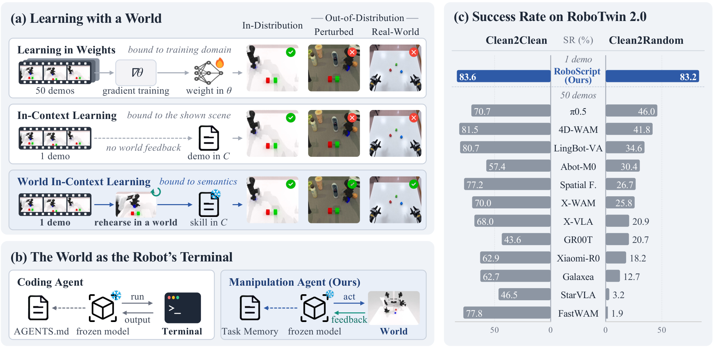
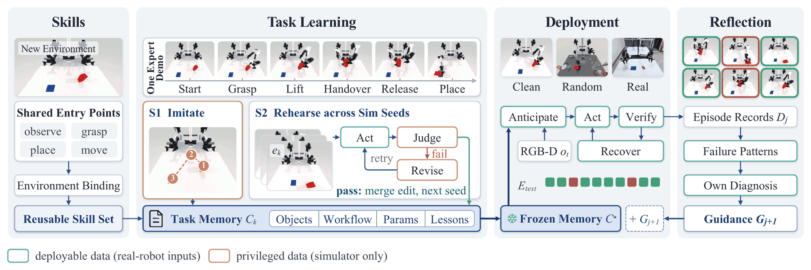
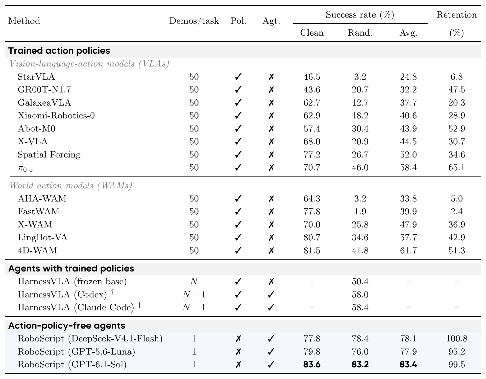
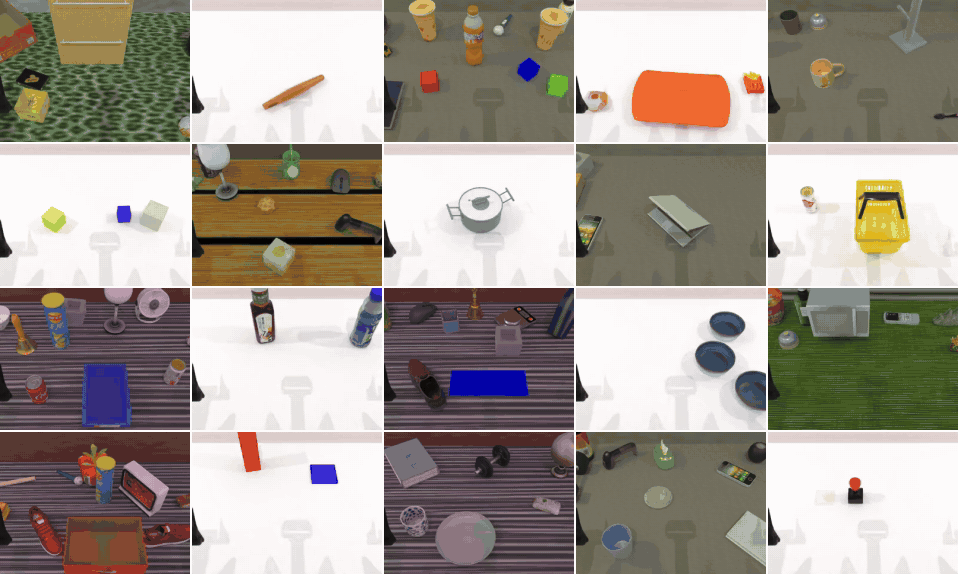
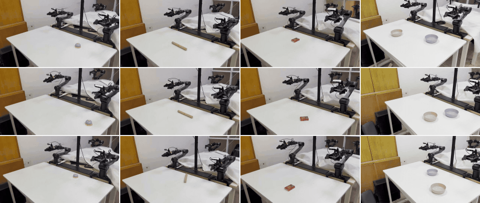
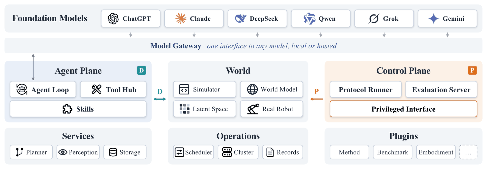

<p align="center">
  <picture>
    <source media="(prefers-color-scheme: dark)" srcset="assets/roboscript-logo/roboscript-logo-dark.svg">
    
  </picture>
</p>

<h1 align="center">World In-Context Learning for Agentic Robot Manipulation</h1>

<p align="center">
  Heng Fang<sup>1</sup> · Zehui Guo<sup>1</sup> · Yuehan Zhang<sup>1</sup> · Mingyang Du<sup>1,2</sup> · <a href="https://dk-liang.github.io/">Dingkang Liang</a><sup>1,2</sup> · <a href="https://scholar.google.com/citations?user=UeltiQ4AAAAJ&hl=en">Xiang Bai</a><sup>1</sup>
  <br>
  <sup>1</sup>Huazhong University of Science and Technology &nbsp;&nbsp; <sup>2</sup>ArcheOne AI
</p>

<!-- badges:start -->
<p align="center">
  <a href="https://arxiv.org/abs/2611.12885"></a>
  <a href="https://ArcheOne-AI.github.io/RoboScript"></a>
  <a href="LICENSE"></a>
  <a href="https://github.com/ArcheOne-AI/RoboScript"></a>
</p>
<!-- badges:end -->

<p align="center">
  <b>Learn a manipulation task in context, not in weights:<br>one demonstration, rehearsal in a world, no gradient updates.</b>
</p>

<p align="center">
  
</p>

RoboScript is an agent framework for robot manipulation without a trained action policy. A frozen
foundation model starts from **one demonstration**, rehearses the task in a world such as a
simulator, and writes what it learns into a **Task Memory** in its context instead of its weights.
We call this **World In-Context Learning (WICL)**.

## 📣 News

- **[2026/11]** We release the [paper](https://arxiv.org/abs/2611.12885) and the [code](https://github.com/ArcheOne-AI/RoboScript).

## 🔍 Overview

<p align="center">
  
</p>

Four stages: build reusable skills from demonstrations, learn a Task Memory from one demonstration,
deploy the frozen Memory on new scenes with only what a real robot can sense, and improve by
reflecting on past evaluations. Currently validated on dual-arm tabletop manipulation.

## 📈 Results

On [RoboTwin 2.0](https://github.com/RoboTwin-Platform/RoboTwin) (50 bimanual tasks), RoboScript
achieves **83.4% mean success** with one demonstration per task and no gradient updates, compared to
61.7% for the strongest trained policy using 50 demonstrations per task. Rehearsal happens only on
clean scenes; randomized scenes see almost no drop (83.6% → 83.2%). Results on additional benchmarks
are in progress.

<details>
<summary><b>Full results table</b></summary>
<br>
<p align="center">
  
</p>

† Randomized setting only, five seeds per task; *N* is the unreported number of demonstrations used
to fine-tune the frozen base.

</details>

**Works on unseen scenes.** Episodes from 20 tasks on clean and randomized scenes; randomized scenes
are never rehearsed. Clips are sped up.

<p align="center">
  
</p>

**Runs on a real robot.** Memories rehearsed on a simulated ALOHA run on a dual-arm PiPER through
parameter remapping, without rehearsing again. Clips are sped up.

<p align="center">
  
</p>

## 🧱 Infrastructure

<p align="center">
  
</p>

Each component runs as its own service. Methods, benchmarks, embodiments and skillsets are plugins.

| Layer | What it does |
|---|---|
| Model gateway | Routes LLM calls to any provider, with session pinning and failover |
| Agent plane | Agent loop, tool Hub, skills — limited to what a real robot can sense |
| Control plane | Runs the learning protocol, holds ground truth. Only the official check decides success |
| Services | Motion planning (cuRobo), perception (GroundingDINO, SAM 3), blob storage |

Add a [benchmark](docs/how-to/add-a-sim-benchmark.md), [skillset](docs/how-to/add-a-skillset.md),
[real robot](docs/how-to/add-a-real-robot.md) or
[other extension](docs/reference/extension-points.md) without changing the core.

## 🛠️ Getting Started

Run one episode on the built-in Mock benchmark. It needs no simulator, GPU or model.

```bash
git clone https://github.com/ArcheOne-AI/RoboScript.git
cd RoboScript
uv sync --all-packages
cd examples/tutorials
uv run python -m quickstart_mock.run
```

Then continue with the [tutorials](examples/tutorials/), pick a benchmark from the table below, or
read the [documentation](docs/README.md). The [vocabulary](docs/architecture.md#vocabulary) defines
terms such as skillset, brain and recipe. To change the code, see [CONTRIBUTING.md](CONTRIBUTING.md).

## 🧩 What's Included

Framework core, three learning methods (`wicl`, `rsi`, `skill_builder`), the vision service, and
a real-robot package. Pre-1.0; interfaces may change.

| Benchmark | Status |
|---|---|
| Mock | Built in, no simulator needed. Used by the [tutorials](examples/tutorials/). |
| [RoboTwin 2.0](examples/simBenchmarks/RoboTwin/README.md) | Full pipeline with official evaluation. |
| [BEHAVIOR](examples/simBenchmarks/BEHAVIOR/README.md) | Integration in development. |

To add another benchmark, see [add-a-sim-benchmark](docs/how-to/add-a-sim-benchmark.md).

## 🗓️ TODO

- [ ] Real-robot deployment code.

## 📝 Citation

```bibtex
@article{fang2026roboscript,
  title   = {World In-Context Learning for Agentic Robot Manipulation},
  author  = {Fang, Heng and Guo, Zehui and Zhang, Yuehan and Du, Mingyang and Liang, Dingkang and Bai, Xiang},
  journal = {arXiv preprint arXiv:2611.12885},
  year    = {2026}
}
```

## 📜 License

Apache License 2.0. See [`LICENSE`](LICENSE) and [`NOTICE`](NOTICE), which lists adapted third-party
code. Benchmark simulators and their assets are not part of this repository and come under their
own licenses.
